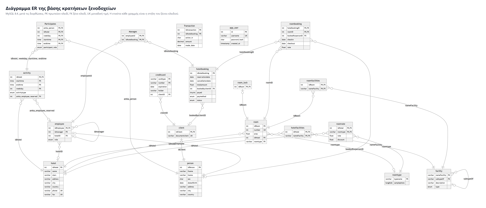
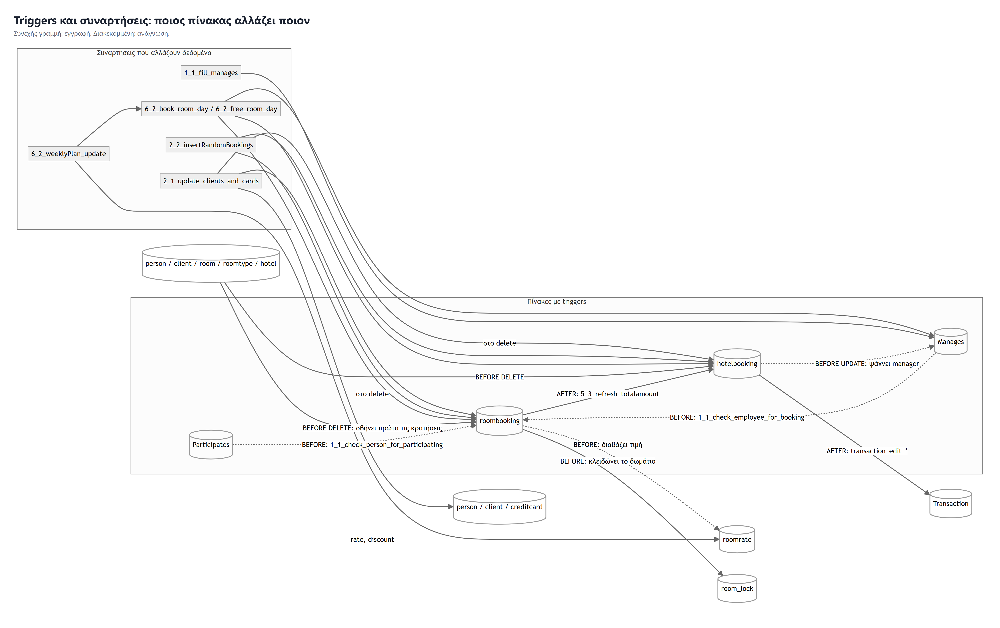

# Βάση δεδομένων κρατήσεων ξενοδοχείων (ΠΛΗ303)

Εργασία του μαθήματος ΠΛΗ303 «Βάσεις Δεδομένων», Πολυτεχνείο Κρήτης, εαρινό εξάμηνο 2020-2021.
Μια βάση PostgreSQL για κρατήσεις ξενοδοχείων, με συναρτήσεις PL/pgSQL, triggers, μία όψη και μια
μικρή εφαρμογή Java (JDBC).

Το README αυτό δείχνει πώς στήνεται η βάση τοπικά με Docker και πώς ελέγχεται η δομή της.
Όλες οι εντολές είναι για **PowerShell σε Windows** και έχουν δοκιμαστεί με Docker 29 και την εικόνα `postgres:16`.

## Περιεχόμενα φακέλου

| Διαδρομή | Τι είναι |
|---|---|
| `Phase1/` | Τα SQL της φάσης Α, όπως γράφτηκαν (σημειώσεις εργασίας, όχι εκτελέσιμα scripts)· στο `Phase1/drafts/` τα πρόχειρα |
| `Phase2/project_base.backup` | Αντίγραφο της βάσης (`pg_dump` custom format, PostgreSQL 11) με σχήμα, δεδομένα, συναρτήσεις και triggers |
| `Phase2/src/db_phase_B/`, `Phase2/pom.xml` | Η εφαρμογή JDBC της φάσης Β (βλ. [Η εφαρμογή Java](#η-εφαρμογή-java-φάση-β)) |
| `db/original/schema.sql` | Το σχήμα όπως είναι μέσα στο backup (πίνακες, συναρτήσεις, triggers, χωρίς δεδομένα), για ανάγνωση |
| `db/fixes/` | Οι διορθώσεις, ως script που εφαρμόζεται πάνω στο backup (βλ. [Διορθώσεις](#διορθώσεις)) |
| `db/checks/01_structure.sql` | Ερωτήματα ελέγχου της δομής |
| `db/checks/02_examples.sql` | Παραδείγματα κλήσης των συναρτήσεων |
| `db/checks/03_fix_tests.sql`, `04_weekly_plan_tests.sql`, `05_review_regressions.sql`, `06_query_function_tests.sql`, `07_port_findings.sql` | Δοκιμές των διορθώσεων |
| `docker-compose.yml` | Τοπική PostgreSQL 16 για το project· με το profile `mysql` και MySQL, phpMyAdmin, web εφαρμογή |
| `db/mysql/` | Η ίδια βάση σε MySQL 8.4 (βλ. [Εκδοχή MySQL](#εκδοχή-mysql-με-phpmyadmin-και-web-εφαρμογή)) |
| `webapp/` | Web εφαρμογή Java με login, πάνω στη MySQL |
| `docs/diagrams/` | Διάγραμμα ER και δομή της βάσης ως εικόνες (βλ. [Διαγράμματα](#διαγράμματα-της-δομής)) |
| `docs/REPORT.md` | Η αναφορά της ομάδας |
| `docs/*.pdf` | Οι εκφωνήσεις των δύο φάσεων |

Η «αλήθεια» για το τι παραδόθηκε είναι το backup: περιέχει και συναρτήσεις που δεν υπάρχουν στα αρχεία του `Phase1/`
(2.2, 3.4-3.7, 4.1, 4.2). Το `db/original/schema.sql` βγήκε από αυτό με `pg_dump --schema-only`.

## Branches

| Branch | Περιεχόμενο |
|---|---|
| `original` | Η παράδοση του Μαΐου 2021, αυτούσια (μαζί με τα `.class` και τα αρχεία του Eclipse) |
| `main` | README, Docker, τακτοποίηση φακέλων και οι μεταγενέστερες διορθώσεις |

## Γρήγορη εκκίνηση

Χρειάζεται μόνο το Docker Desktop να τρέχει.

**1. Μπείτε στον φάκελο του project.** Βάλτε τη δική σας διαδρομή. Στο παράδειγμα το όνομα του φακέλου έχει κενό και
παρένθεση, γι' αυτό χρειάζονται το `-LiteralPath` και τα μονά εισαγωγικά:

```powershell
Set-Location -LiteralPath 'C:\Users\Antonis-PC\OneDrive\Desktop\sql_projects\6) Our'
```

Όλες οι επόμενες εντολές τρέχουν μέσα από αυτόν τον φάκελο.

**2. Ξεκινήστε το container.**

```powershell
docker compose up -d --wait
```

Αναμένεται στο τέλος `Container hotel-db Healthy`. Δημιουργείται ένα container `hotel-db` με μια άδεια βάση `hotel`.

**3. Επαναφέρετε το backup.**

```powershell
docker compose exec db pg_restore -U postgres -d hotel --no-owner --no-privileges /backup/project_base.backup
```

Δεν τυπώνει τίποτα όταν πετύχει και διαρκεί λίγα δευτερόλεπτα. Γίνεται μία φορά: αν το ξανατρέξετε στην ίδια βάση θα βγάλει σφάλματα «already exists» (βλ. [Καθαρή επανεκκίνηση](#σταμάτημα-και-καθάρισμα)).

**4. Επιβεβαιώστε ότι φορτώθηκε.**

```powershell
docker compose exec db psql -U postgres -d hotel -c "SELECT count(*) FROM hotel;"
```

Αναμένεται `101`.

## Σύνδεση με psql

```powershell
docker compose exec db psql -U postgres -d hotel
```

Ανοίγει διαδραστικό `psql` με prompt `hotel=#`. Έξοδος με `\q`.

Μέσα στο container δεν ζητείται κωδικός. Από εργαλείο στον υπολογιστή σας (pgAdmin, DBeaver, η εφαρμογή Java) τα στοιχεία είναι:

| | |
|---|---|
| Host | `127.0.0.1` |
| Port | `5433` |
| Database | `hotel` |
| User | `postgres` |
| Password | η τιμή της `POSTGRES_PASSWORD` (προεπιλογή `local_dev_only`) |

Ο κωδικός είναι placeholder για τοπική χρήση και η θύρα ακούει μόνο στο `127.0.0.1`. Για άλλη τιμή ή άλλη θύρα,
αντιγράψτε το `.env.example` σε `.env` και αλλάξτε το **πριν** από το πρώτο `docker compose up`
(ο κωδικός ορίζεται μόνο όταν δημιουργείται η βάση):

```powershell
Copy-Item .env.example .env
```

## Έλεγχος της δομής

### Όλα μαζί

```powershell
docker compose exec db psql -U postgres -d hotel -f /sql/checks/01_structure.sql
```

Τρέχει δώδεκα ελέγχους, καθένας με επικεφαλίδα `=== ... ===`. Αναμενόμενα πλήθη:

| Έλεγχος | Μετά το restore | Μετά και τις [διορθώσεις](#διορθώσεις) |
|---|---|---|
| 1. Πίνακες | 17 | 17 |
| 2. Στήλες | 79 | 79 |
| 3. Πρωτεύοντα κλειδιά και UNIQUE | 22 (17 PK, 5 UNIQUE) | 22 |
| 4. Ξένα κλειδιά | 25 | 24 |
| 5. Περιορισμοί CHECK | 5 | 5 |
| 6. Τύποι ENUM | 7 | 7 |
| 7. Sequences | 5 | 5 |
| 8. Ευρετήρια | 37 | 37 |
| 9. Συναρτήσεις | 29 | 39 |
| 10. Triggers | 9 | 12 |
| 11. Όψεις | 1 (`6_1_availableRoomsByHotel`) | 2 (και `6_2_weeklyPlan`) |
| 12. Πλήθος γραμμών | βλ. παρακάτω | ίδιο |

Πλήθος γραμμών ανά πίνακα:

| Πίνακας | Γραμμές | Πίνακας | Γραμμές |
|---|---:|---|---:|
| `person` | 10001 | `roomrate` | 823 |
| `client` | 6213 | `roomtype` | 15 |
| `creditcard` | 6212 | `facility` | 79 |
| `employee` | 2055 | `hotelfacilities` | 3206 |
| `hotel` | 101 | `roomfacilities` | 28564 |
| `room` | 2034 | `Activity` | 4 |
| `hotelbooking` | 6214 | `Participates` | 5 |
| `roombooking` | 14221 | `Manages` | 446 |
| | | `Transaction` | 0 |

Για να κρατήσετε την έξοδο σε αρχείο:

```powershell
docker compose exec db psql -U postgres -d hotel -f /sql/checks/01_structure.sql | Out-File -Encoding utf8 structure.txt
```

### Ένας-ένας έλεγχος

Οι εντολές `\d...` του `psql` δουλεύουν και απευθείας από το PowerShell:

```powershell
docker compose exec db psql -U postgres -d hotel -c "\dt"
```

Λίστα πινάκων, τελευταία γραμμή `(17 rows)`.

```powershell
docker compose exec db psql -U postgres -d hotel -c "\d roombooking"
```

Στήλες, πρωτεύον κλειδί, ευρετήρια, 3 ξένα κλειδιά και 6 triggers του πίνακα `roombooking`. Βάλτε όποιον πίνακα θέλετε.

| Εντολή μέσα στο `psql` | Τι δείχνει |
|---|---|
| `\dt` | πίνακες |
| `\d roombooking` | στήλες, κλειδιά, περιορισμοί, triggers ενός πίνακα |
| `\d "Activity"` | το ίδιο για πίνακα με κεφαλαίο στο όνομα (θέλει διπλά εισαγωγικά) |
| `\dT+` | τύποι ENUM με τις τιμές τους |
| `\ds` | sequences |
| `\df` | συναρτήσεις |
| `\dv` | όψεις |
| `\sf "4_2_countAvgAge"` | ο κώδικας μιας συνάρτησης |
| `\d+ "6_1_availableRoomsByHotel"` | ο ορισμός της όψης |

## Παραδείγματα κλήσης συναρτήσεων

```powershell
docker compose exec db psql -U postgres -d hotel -f /sql/checks/02_examples.sql
```

Καλεί εννέα από τις συναρτήσεις/όψεις του project, όλες μόνο για ανάγνωση. Ενδεικτικά αποτελέσματα:

| Κλήση | Αναμένεται |
|---|---|
| `"3_6_findSubtypesOfAFacility"('Business Services')` | 6 γραμμές (Fax, Laptop rental, Lounge, …) |
| `"3_4_displayBookingStatus"(11)` | πρώτη γραμμή: κράτηση 105, `Employee` (μετά τις διορθώσεις με όνομα `Armani Dean`) |
| `"3_8_search_hotels_having_room_from_each_category"()` | 5 ξενοδοχεία· 101 μετά τις διορθώσεις |
| `"4_3_search_cheap_rooms_by_country"('Russia')` | πρώτη γραμμή: `Sukhoy Log`, `Apartment` (μετά τις διορθώσεις και τιμή `45`) |
| `"4_5_find_hotel_fullness"(11, 2021)` | 8 γραμμές, Ιούλιος 70.73· μετά τις διορθώσεις 12 γραμμές, Ιούλιος 63.41 |
| `"4_2_countAvgAge"('Studio')` | 45.17 το 2026· μετά τις διορθώσεις 45.02 (υπολογίζεται με τη σημερινή ημερομηνία) |
| `"6_1_availableRoomsByHotel"` | 0 γραμμές μετά το restore (βλ. σημείωση)· 2034 μετά τις διορθώσεις |

Δύο πράγματα που αξίζει να ξέρετε:

- **Τα ονόματα των συναρτήσεων ξεκινούν με ψηφίο, άρα θέλουν πάντα διπλά εισαγωγικά.**
  Το Windows PowerShell 5.1 όμως αφαιρεί τα διπλά εισαγωγικά όταν περνά το όρισμα του `-c` στο `docker`, και η κλήση
  αποτυγχάνει με `trailing junk after numeric literal`. Γι' αυτό τρέξτε τις κλήσεις είτε από αρχείο `.sql` (όπως παραπάνω)
  είτε μέσα στο διαδραστικό `psql`:

  ```sql
  SELECT * FROM "4_2_countAvgAge"('Studio');
  ```

- **Οι κρατήσεις του dataset καλύπτουν 13/01/2021 έως 31/05/2022.** Ό,τι συγκρίνει με τη σημερινή ημερομηνία
  (`current_date`) βλέπει πλέον όλες τις κρατήσεις ως παρελθούσες. Γι' αυτό η αρχική όψη 6.1, που ζητούσε μελλοντική
  κράτηση, επιστρέφει 0 γραμμές, ενώ η διορθωμένη τα βγάζει όλα ελεύθερα.

Για δικά σας ερωτήματα, προσθέστε ένα αρχείο `.sql` στον φάκελο `db/` και τρέξτε το με `-f /sql/<αρχείο>.sql`
(ο φάκελος `db/` φαίνεται μέσα στο container ως `/sql`, μόνο για ανάγνωση).

## Διορθώσεις

Το backup μένει όπως παραδόθηκε. Οι διορθώσεις είναι ένα ξεχωριστό script που τρέχει **μετά** το restore
(όλα ή τίποτα· μπορεί να ξανατρέξει):

```powershell
docker compose exec db psql -U postgres -d hotel -v ON_ERROR_STOP=1 --single-transaction -f /sql/fixes/apply.sql
```

Τυπώνει πέντε αποτελέσματα `setval` και μερικά `CREATE FUNCTION` / `CREATE VIEW`, χωρίς `ERROR`. Την πρώτη φορά
βγάζει και δύο `NOTICE: ... does not exist, skipping`, που είναι αναμενόμενα.

Δοκιμές (τρέχουν μέσα σε transaction που κάνει ROLLBACK, δεν αφήνουν τίποτα στη βάση):

```powershell
docker compose exec db psql -U postgres -d hotel -f /sql/checks/03_fix_tests.sql
```

```powershell
docker compose exec db psql -U postgres -d hotel -f /sql/checks/04_weekly_plan_tests.sql
```

```powershell
docker compose exec db psql -U postgres -d hotel -f /sql/checks/05_review_regressions.sql
```

```powershell
docker compose exec db psql -U postgres -d hotel -f /sql/checks/06_query_function_tests.sql
```

```powershell
docker compose exec db psql -U postgres -d hotel -f /sql/checks/07_port_findings.sql
```

Αναμένονται 9, 3, 12, 7 και 2 γραμμές `OK ...` αντίστοιχα, και στο τέλος της καθεμιάς `ALL TESTS PASSED`.

Τι διορθώθηκε (λεπτομέρειες στα σχόλια των αρχείων του `db/fixes/`):

| Ερώτημα | Πρόβλημα στην παράδοση | Διόρθωση |
|---|---|---|
| sequences | Ήταν πίσω από τα μέγιστα id· κάθε `nextval` έδινε duplicate key | Συγχρονισμός με τα μέγιστα id |
| 2.1 | Το `'update'` έσκαγε (alias μέσα στο `SET`, ανύπαρκτη μεταβλητή)· ληγμένη κάρτα άφηνε πελάτη χωρίς κάρτα | Σωστό `UPDATE`, προσθήκη κάρτας αν λείπει· σφάλμα σε ληγμένη κάρτα ή άγνωστο πελάτη |
| 2.2 | Έσκαγε (sequence, alias `pe`)· ίδιες ημερομηνίες και πλήθος δωματίων για όλες τις κρατήσεις· δεν απέκλειε υπαλλήλους | Τρέχει· τυχαία επιλογή ανά κράτηση· χωρίς υπαλλήλους του ξενοδοχείου |
| 3.4 | Έδειχνε τον υπεύθυνο κάθε δωματίου, μία γραμμή ανά δωμάτιο και υπάλληλο (162 γραμμές για 57 κρατήσεις) | Μία γραμμή ανά κράτηση, με τον πελάτη που την έκανε |
| 3.7 | Ακολουθούσε μόνο ένα επίπεδο υπο-παροχών (1439 δωμάτια αντί 1467 σε ένα παράδειγμα) | Αναδρομικά όλα τα επίπεδα |
| 3.8 | Ζητούσε κάθε τύπο δωματίου που υπάρχει οπουδήποτε (5 ξενοδοχεία) | Ελεύθερο δωμάτιο από κάθε τύπο που έχει το ίδιο το ξενοδοχείο |
| 4.1 | Έλεγχος σε `checkout` αντί `checkin`· οι συμμετοχές πολλαπλασιάζονταν με τις κρατήσεις | Μία γραμμή ανά πελάτη και ξενοδοχείο διαμονής |
| 4.2 | Διαφορά ετών γέννησης, μία φορά ανά κράτηση δωματίου | Πραγματική ηλικία, μία φορά ανά πρόσωπο |
| 4.3 | Επέστρεφε πόλη και τύπο, όχι την τιμή | Νέα στήλη `min_rate` (αλλάζει ο τύπος επιστροφής) |
| 4.4 | Το ποσό μιας κράτησης αθροιζόταν μία φορά ανά δωμάτιό της | Μία φορά ανά κράτηση |
| 4.5 | Μετρούσε αφίξεις του μήνα (τιμές έως 600%), παρέλειπε μήνες χωρίς άφιξη | Ποσοστό δωματίων με δεσμευμένη νύχτα, για κάθε έναν από τους 12 μήνες |
| 5.1 | Η διαγραφή πληρωμένης κράτησης έσκαγε· `payed` true→false→true χρέωνε δύο φορές· οι αλλαγές `status` δεν καταγράφονταν | Καταγράφεται πάντα η διαφορά του εισπραγμένου ποσού· το `Transaction` δεν έχει πια ξένο κλειδί προς την κράτηση, για να μένει το ιστορικό |
| 5.2 | Η προθεσμία ακύρωσης μηδενιζόταν (NULL) χωρίς manager· ακύρωση, μείωση τιμής και μεταφορά δωματίου περνούσαν μετά την προθεσμία | Έλεγχος με `IS DISTINCT FROM`· απορρίπτονται και οι τρεις παρακάμψεις |
| 5.3 insert | Ο έλεγχος διαθεσιμότητας κοίταζε το `OLD` (NULL), άρα επέτρεπε διπλοκράτηση· NULL ημερομηνίες και δωμάτια χωρίς τιμή περνούσαν | Κοιτά το `NEW`· απορρίπτει NULL και δωμάτιο χωρίς τιμή· κλείδωμα ανά δωμάτιο για ταυτόχρονες κρατήσεις |
| 5.3 update | Το `rate` δεν ανανεωνόταν· αλλαγή δωματίου δεν ελεγχόταν· διαμονή που είχε αρχίσει δεν παρατεινόταν | Τρέχουσα τιμή, εκτός αν το `UPDATE` ορίζει `rate`· έλεγχος διαθεσιμότητας στο νέο δωμάτιο· επιτρέπεται η παράταση |
| 6.1 | Καρφωτό ξενοδοχείο· έλειπαν τα δωμάτια χωρίς μελλοντική κράτηση | Όψη για όλα τα ξενοδοχεία και συνάρτηση `"6_1_availableRoomsByHotel_function"(όνομα)` |
| 6.2 | Δεν είχε υλοποιηθεί | Όψη `"6_2_weeklyPlan"` με `INSTEAD OF` triggers |

Οι διορθώσεις ελέγχθηκαν και από ανεξάρτητη ανασκόπηση που πυροδότησε τα triggers στη βάση· όσα βρήκε και διορθώθηκαν
καλύπτονται από το `05_review_regressions.sql`. Οι συναρτήσεις των ερωτημάτων 3 και 4 συγκρίνονται στο
`06_query_function_tests.sql` με ανεξάρτητα γραμμένα ερωτήματα πάνω σε όλα τα δεδομένα.

Δύο ακόμα λάθη βρέθηκαν όταν η βάση συγκρίθηκε, σενάριο προς σενάριο, με τη [μεταφορά της σε MySQL](#εκδοχή-mysql-με-phpmyadmin-και-web-εφαρμογή),
και καλύπτονται από το `07_port_findings.sql`:

- **5.3 update:** το πρώτο `UPDATE` κράτησης δωματίου σε κάθε νέα σύνδεση δεν ανανέωνε το `rate` (από το δεύτερο και
  μετά δούλευε, γι' αυτό δεν το έπιαναν οι προηγούμενες δοκιμές).
- **2.1 delete:** η διαγραφή πελάτη αποτύγχανε με σφάλμα ξένου κλειδιού όταν οι κρατήσεις του είχαν δημιουργηθεί μέσα
  στην ίδια συναλλαγή. Το 2.1 σβήνει τώρα ρητά τις κρατήσεις πριν από το πρόσωπο. Ένα απευθείας `DELETE FROM person`
  στην ίδια περίπτωση εξακολουθεί να αποτυγχάνει.

Σύμβαση που ακολουθείται πλέον παντού: μια κράτηση πιάνει τις νύχτες από το `checkin` έως πριν το `checkout`,
άρα νέα κράτηση μπορεί να αρχίζει την ημέρα που η προηγούμενη κάνει checkout.

### Η όψη 6.2 (εβδομαδιαίο πλάνο)

Δείχνει την εβδομάδα μετά την τρέχουσα (Κυριακή έως Σάββατο), μία γραμμή ανά δωμάτιο: τιμή, έκπτωση και για κάθε
ημέρα το `documentclient` του πελάτη ή `'0'` αν το δωμάτιο είναι ελεύθερο. Μέσα στο `psql`:

```sql
SELECT room_number, rate, discount, sunday, monday, tuesday, wednesday, thursday, friday, saturday
FROM "6_2_weeklyPlan" WHERE "idHotel" = 11;
```

Επιτρέπονται μόνο ενημερώσεις στα `rate`, `discount` και στις επτά στήλες ημερών:

```sql
BEGIN;
UPDATE "6_2_weeklyPlan" SET monday = (SELECT documentclient FROM client WHERE "idClient" = 4971)
WHERE "idRoom" = 250;                                       -- κλείσιμο της Δευτέρας
UPDATE "6_2_weeklyPlan" SET monday = '0' WHERE "idRoom" = 250;   -- απελευθέρωση
ROLLBACK;
```

Το `rate`/`discount` ορίζεται ανά τύπο δωματίου, οπότε η αλλαγή του ισχύει για όλα τα δωμάτια του ίδιου τύπου στο
ξενοδοχείο.

### Γνωστά ανοιχτά σημεία

Triggers και δεδομένα:

- Το dataset περιέχει ήδη 857 ζεύγη επικαλυπτόμενων κρατήσεων για το ίδιο δωμάτιο (2021-2022)· οι διορθώσεις εμποδίζουν
  τις νέες, δεν καθαρίζουν τις παλιές. Γι' αυτό δεν μπήκε περιορισμός αποκλεισμού (exclusion constraint) στον πίνακα.
- Μια ακυρωμένη κράτηση (`status = 'canceled'`) συνεχίζει να πιάνει το δωμάτιό της.
- Η διαγραφή πελάτη με το 2.1 αποτυγχάνει για σχεδόν όλους τους υπάρχοντες πελάτες: η διαγραφή φτάνει με cascade στις
  κρατήσεις τους και το trigger τη σταματά επειδή έχει περάσει η προθεσμία ακύρωσης.
- Τα μηνύματα «Room available until/after» του trigger ενημέρωσης δίνουν σωστή ημερομηνία μόνο όταν υπάρχει επόμενη
  κράτηση. Όταν η παράταση απορρίπτεται, το σφάλμα λέει πλέον ως πότε μπορεί να φτάσει το checkout.
- Η αλλαγή έκπτωσης στο `roomrate` δεν ξανατιμολογεί τις υπάρχουσες κρατήσεις· το `rate` ανανεώνεται στην επόμενη
  ενημέρωση της κάθε κράτησης.
- Όλα τα ξένα κλειδιά του αρχικού σχήματος είναι `NOT VALID` και δύο `CHECK` καλούν συναρτήσεις που διαβάζουν άλλους
  πίνακες· δεν αλλάχτηκαν.

Ερωτήματα 3 και 4, θέματα ερμηνείας που έμειναν όπως τα όρισε η ομάδα:

- 3.4: `bookedBy = 'Employee'` σημαίνει ότι την κράτηση τη διαχειρίζεται υπάλληλος (πίνακας `Manages`).
- 4.1: «πελάτης που σχετίζεται με ξενοδοχείο» είναι ο υπεύθυνος δωματίου με άφιξη έως σήμερα· όσοι μόνο έκαναν κρατήσεις
  για άλλους δεν εμφανίζονται.
- 4.4: ο μέσος όρος της πόλης υπολογίζεται μόνο στα ξενοδοχεία που έχουν εισπράξεις. Στο dataset το `totalamount` είναι
  NULL σε 6206 από τις 6214 κρατήσεις, οπότε το αποτέλεσμα είναι ένα ξενοδοχείο.
- 4.5: ένα δωμάτιο μετρά ως δεσμευμένο τον μήνα αν έχει έστω μία δεσμευμένη νύχτα μέσα σε αυτόν.

## Η εφαρμογή Java (φάση Β)

Δεν χρειάζεται εγκατεστημένη Java: η εφαρμογή μεταγλωττίζεται και τρέχει μέσα σε container με Maven
(την πρώτη φορά κατεβαίνουν η εικόνα και ο οδηγός JDBC, περίπου ένα λεπτό).

```powershell
docker compose run --rm app
```

Στις ερωτήσεις σύνδεσης δώστε:

| Ερώτηση | Απάντηση |
|---|---|
| Database address | `db` |
| Database name | `hotel` |
| Username | `postgres` |
| Password | η τιμή της `POSTGRES_PASSWORD` (προεπιλογή `local_dev_only`) |

Αναμένεται `Connection successful!` και το κεντρικό μενού. Ενδεικτική διαδρομή: `1`, πρόθεμα `ram`, ξενοδοχείο `1`
(Ramblewood Inn), μετά `1` με πρόθεμα `a` (3 πελάτες), ή `3` με ημερομηνίες `2030-05-01` και `2030-05-04` (11 ελεύθερα
δωμάτια) για νέα κράτηση. Έξοδος με `0` και μετά `2`.

Για κρατήσεις μέσα από την εφαρμογή πρέπει να έχουν εφαρμοστεί οι [διορθώσεις](#διορθώσεις): αλλιώς το sequence των
κρατήσεων δίνει id που υπάρχει ήδη.

Με δική σας Java 17+ και Maven, από τον φάκελο `Phase2`: `mvn compile exec:java`, με διεύθυνση `127.0.0.1:5433`.

Τι άλλαξε σε σχέση με την παράδοση (ο αρχικός κώδικας είναι στο branch `original`):

- Όλα τα ερωτήματα είναι `PreparedStatement` με παραμέτρους. Πριν, ό,τι πληκτρολογούσε ο χρήστης κολλούσε μέσα στο
  κείμενο του SQL (SQL injection).
- Η ενημέρωση κράτησης δουλεύει: πριν εκτελούνταν με `executeQuery`, χωρίς εισαγωγικά στις ημερομηνίες, χωρίς κενό
  πριν το `WHERE` και χωρίς `commit`.
- Το μενού ακολουθεί την εκφώνηση (επιλογή ξενοδοχείου με αύξοντα αριθμό, υπο-ερωτήματα i, ii, iii, `0` για επιστροφή)
  και τερματίζει κανονικά. Προστέθηκε το υπο-ερώτημα iii (διαθέσιμα δωμάτια και νέα κράτηση), που έλειπε.
- Το `StandardInputRead.java` ξαναγράφτηκε, γιατί από την παράδοση είχε μείνει μόνο το `.class`.
- Προστέθηκε `pom.xml` για μεταγλώττιση με τον οδηγό JDBC της PostgreSQL.
- Ένα σφάλμα της βάσης ακυρώνει μόνο την τρέχουσα ενέργεια και επιστρέφει στο μενού, δεν τερματίζει το πρόγραμμα.
- Και τα τρία υπο-ερωτήματα θεωρούν «πελάτη του ξενοδοχείου» όποιον έχει γραμμή στον πίνακα `client` και είναι
  υπεύθυνος σε κράτηση δωματίου του. Νέα κράτηση με άφιξη στο παρελθόν δεν γίνεται δεκτή.

Η παράδοση ζητούσε Eclipse project· εδώ είναι Maven project (στο Eclipse: *Import → Existing Maven Projects*).

## Διαγράμματα της δομής

Στο `docs/diagrams/` υπάρχει η δομή της βάσης ως εικόνες. Βγήκαν από τα μεταδεδομένα της MySQL (`information_schema`)
μετά τις διορθώσεις· οι πίνακες και τα ξένα κλειδιά είναι ίδια και στην PostgreSQL, εκτός από τους `app_user` και
`room_lock`, που υπάρχουν μόνο στη MySQL.

| Αρχείο | Τι δείχνει |
|---|---|
| `docs/diagrams/er-diagram.png` | Διάγραμμα ER: οι 19 πίνακες με όλες τις στήλες και τα 25 ξένα κλειδιά |
| `docs/diagrams/triggers-flow.png` | Ποιος πίνακας αλλάζει ή διαβάζει ποιον μέσω triggers και συναρτήσεων |
| `docs/diagrams/db-structure.png` | Όλη η δομή σε μία σελίδα: ER, πίνακες, συναρτήσεις, triggers και όψεις, με περιγραφές |
| `docs/diagrams/*.mmd` | Ο κώδικας Mermaid των δύο διαγραμμάτων, για αλλαγές |





## Εκδοχή MySQL με phpMyAdmin και web εφαρμογή

Η ίδια βάση, με τις διορθώσεις, υπάρχει και σε MySQL 8.4, μαζί με phpMyAdmin και μια web εφαρμογή Java με login.
Είναι ανεξάρτητη από την PostgreSQL: τρέχει σε δικά της containers και ξεκινά με το profile `mysql`.

```powershell
docker compose --profile mysql up -d --wait
```

Την πρώτη φορά η MySQL φορτώνει μόνη της το σχήμα, τα δεδομένα και τις routines από το `db/mysql/init/`
(λίγα δευτερόλεπτα) και η web εφαρμογή μεταγλωττίζεται: η σελίδα της απαντά λίγο μετά το `Healthy`, ή σε περίπου
ένα λεπτό την πρώτη φορά που κατεβαίνουν οι βιβλιοθήκες της.

| Τι | Διεύθυνση | Σύνδεση |
|---|---|---|
| Web εφαρμογή | <http://127.0.0.1:8080> | χρήστης `admin`, κωδικός η τιμή της `APP_ADMIN_PASSWORD` |
| phpMyAdmin | <http://127.0.0.1:8081> | χρήστης `root` ή `hotel_app`, κωδικός η τιμή της `MYSQL_ROOT_PASSWORD` ή `MYSQL_PASSWORD` |
| MySQL από εργαλείο στον υπολογιστή | `127.0.0.1:3307`, βάση `hotel` | όπως στο phpMyAdmin |

Όλοι οι κωδικοί έχουν προεπιλογή `local_dev_only` (placeholder για τοπική χρήση) και όλες οι θύρες ακούν μόνο στο
`127.0.0.1`. Αλλάζουν από το `.env` (βλ. `.env.example`) **πριν** από την πρώτη εκκίνηση.

Γραμμή εντολών MySQL μέσα στο container:

```powershell
docker compose exec mysql sh -c 'mysql -uroot -p"$MYSQL_ROOT_PASSWORD" hotel'
```

### Αρχεία

| Διαδρομή | Τι είναι |
|---|---|
| `db/mysql/init/01_schema.sql` | Πίνακες, κλειδιά, ευρετήρια και ο πίνακας `app_user` της web εφαρμογής |
| `db/mysql/init/02_data.sql` | Τα δεδομένα του backup ως `INSERT` (παράγεται, βλ. παρακάτω) |
| `db/mysql/init/03_query_routines.sql` | Ερωτήματα 1.1, 3.1-3.8, 4.1-4.5 και 6.1 |
| `db/mysql/init/04_triggers.sql` | Ερωτήματα 2.1, 2.2, τα triggers των 5.1-5.3 και ο βοηθητικός πίνακας `room_lock` |
| `db/mysql/init/05_weekly_plan.sql` | Ερώτημα 6.2 |
| `db/mysql/checks/` | Έλεγχος δομής, παραδείγματα κλήσης και δοκιμές |
| `db/mysql/tools/export_from_postgres.sh` | Ξαναφτιάχνει το `02_data.sql` από το backup της PostgreSQL |
| `webapp/` | Η web εφαρμογή (Maven, Java 17, Javalin) |

Τα αρχεία 03-05 μπορούν να ξανατρέξουν πάνω σε υπάρχουσα βάση, π.χ. μετά από αλλαγή:

```powershell
docker compose exec mysql sh -c 'mysql -uroot -p"$MYSQL_ROOT_PASSWORD" hotel < /docker-entrypoint-initdb.d/04_triggers.sql'
```

### Τι αλλάζει σε σχέση με την PostgreSQL

Οι πίνακες, τα δεδομένα και οι κανόνες είναι οι ίδιοι. Αλλάζει ο τρόπος που καλούνται ορισμένα πράγματα:

| PostgreSQL | MySQL |
|---|---|
| `SELECT * FROM "3_6_findSubtypesOfAFacility"('Business Services')` | ``CALL `3_6_findSubtypesOfAFacility`('Business Services')``: οι συναρτήσεις που επιστρέφουν πίνακα έγιναν procedures |
| `SELECT "2_1_update_clients_and_cards"(...)` | ``SELECT `2_1_update_clients_and_cards`(...)``: τα 2.1 και 2.2 έμειναν συναρτήσεις, ώστε μια αποτυχία στη μέση να αναιρεί όλη την κλήση |
| `UPDATE "6_2_weeklyPlan" SET monday = ...` | ``SELECT `6_2_weeklyPlan_update`(idRoom, rate, discount, sunday, ..., saturday)``: η MySQL δεν έχει `INSTEAD OF` triggers. `NULL` σημαίνει «μην το αλλάξεις», `'0'` απελευθερώνει την ημέρα |
| ονόματα σε `"διπλά εισαγωγικά"` | ονόματα σε `` `ανάποδα εισαγωγικά` `` (χρειάζονται μόνο όσα αρχίζουν με ψηφίο) |
| sequences | `AUTO_INCREMENT` |
| `RAISE EXCEPTION` | `SIGNAL SQLSTATE '45000'` με το ίδιο μήνυμα· τα `RAISE NOTICE` δεν έχουν αντίστοιχο και λείπουν |
| δύο `CHECK` που καλούν συνάρτηση (`Manages`, `Participates`) | triggers στους ίδιους πίνακες |

Διαφορές συμπεριφοράς που αξίζει να ξέρετε:

- **Τα cascades δεν εκτελούν triggers.** Όταν μια γραμμή σβήνεται λόγω `ON DELETE CASCADE`, η MySQL δεν τρέχει τα triggers
  της. Γι' αυτό υπάρχουν πέντε επιπλέον `BEFORE DELETE` triggers (σε `person`, `client`, `room`, `roomtype`, `hotel`) που
  σβήνουν πρώτα ρητά τις κρατήσεις. Έτσι η διαγραφή ενός προσώπου ή ενός δωματίου απορρίπτεται όταν μια κράτησή του έχει
  περάσει την προθεσμία ακύρωσης, όπως στην PostgreSQL, και τα ποσά και οι συνδιαλλαγές ενημερώνονται.
- **Μια εντολή πάνω στο `roombooking` δεν μπορεί να διαβάζει το `hotelbooking`** (και αντίστροφα), γιατί τα triggers του
  ενός αλλάζουν το άλλο (σφάλμα 1442). Για παράδειγμα το
  `UPDATE roombooking ... WHERE hotelbookingID IN (SELECT ... FROM hotelbooking ...)` απορρίπτεται· βρείτε πρώτα τα id με
  ξεχωριστό `SELECT`. Το `room` μπορεί να διαβάζεται κανονικά.
- **Κλείδωμα ανά δωμάτιο.** Αντί για το advisory lock της PostgreSQL, τα triggers κλειδώνουν μια γραμμή του βοηθητικού
  πίνακα `room_lock` (μία γραμμή ανά δωμάτιο). Δύο ταυτόχρονες κρατήσεις του ίδιου δωματίου δεν περνούν ποτέ και οι δύο.
  Όταν όμως μια κράτηση αλλάζει την ίδια στιγμή που μπαίνει άλλη στο ίδιο δωμάτιο, η MySQL μπορεί να ακυρώσει τη μία
  εντολή με σφάλμα 1213 (deadlock)· η εντολή απλώς ξαναδοκιμάζεται. Η web εφαρμογή το κάνει μόνη της.
- **Ποσά στο `Transaction`.** Το `totalamount` είναι `FLOAT`, και η MySQL το γράφει στο `Transaction` με όλα τα δεκαδικά
  του, ενώ η PostgreSQL το στρογγυλεύει σε 6 σημαντικά ψηφία. Με ακέραιες τιμές, όπως του dataset, τα ποσά είναι ίδια.
- **Ρητό `rate` στο `UPDATE`.** Η PostgreSQL ξέρει αν το `UPDATE` όρισε `rate`. Η MySQL όχι, οπότε το trigger θεωρεί ότι
  ορίστηκε όταν η νέα τιμή διαφέρει από την παλιά. Ένα `UPDATE` που ξαναγράφει την ίδια τιμή παίρνει την τρέχουσα τιμή του
  δωματίου.
- **Ξένο κλειδί `idmanagerFK`.** Στην PostgreSQL είχε οριστεί κατά λάθος πάνω στο `idEmployee`. Η MySQL δεν δέχεται τέτοιο
  ορισμό, οπότε εδώ δείχνει από το `idmanager` στον υπάλληλο-προϊστάμενο.

### Έλεγχοι

```powershell
docker compose exec mysql sh -c 'mysql -uroot -p"$MYSQL_ROOT_PASSWORD" hotel --table < /sql/checks/01_structure.sql'
```

```powershell
docker compose exec mysql sh -c 'mysql -uroot -p"$MYSQL_ROOT_PASSWORD" hotel --table < /sql/checks/02_examples.sql'
```

```powershell
docker compose exec mysql sh -c 'mysql -uroot -p"$MYSQL_ROOT_PASSWORD" hotel < /sql/checks/03_trigger_tests.sql'
```

Ο πρώτος δείχνει τη δομή: 19 πίνακες (οι 17 της εργασίας, ο `app_user` και ο `room_lock`), 25 ξένα κλειδιά, 29
συναρτήσεις και procedures, 21 triggers και 2 όψεις. Ο δεύτερος καλεί τα ερωτήματα με τα ίδια ορίσματα που έχει το
`db/checks/02_examples.sql`. Ο τρίτος δοκιμάζει τα triggers και τις συναρτήσεις μέσα σε συναλλαγή που κάνει `ROLLBACK`:
τυπώνει 38 γραμμές `OK ...` και τελειώνει με `ALL TESTS PASSED`.

Κάθε εντολή τυπώνει πρώτα μια προειδοποίηση `Using a password on the command line interface can be insecure`· είναι
αναμενόμενη.

### Η web εφαρμογή

Κάνει ό,τι και η εφαρμογή κονσόλας της φάσης Β, σε σελίδες: αναζήτηση ξενοδοχείου με τα αρχικά του ονόματος και, για το
ξενοδοχείο που θα επιλέξετε, πελάτες με τα αρχικά του επωνύμου, κρατήσεις δωματίων ενός πελάτη με ενημέρωση, και διαθέσιμα
δωμάτια για μια περίοδο με νέα κράτηση. Ό,τι απορρίπτουν τα triggers εμφανίζεται ως μήνυμα στη σελίδα.

- **Χρήστες.** Αποθηκεύονται στον πίνακα `app_user`, με τον κωδικό μόνο ως BCrypt hash. Όταν ο πίνακας είναι άδειος, η
  εφαρμογή δημιουργεί στην εκκίνηση τον χρήστη των `APP_ADMIN_USER` / `APP_ADMIN_PASSWORD`. Η αλλαγή αυτών των μεταβλητών
  αργότερα δεν αλλάζει υπάρχοντα χρήστη.
- **Σύνδεση με τη βάση.** Η εφαρμογή συνδέεται ως `hotel_app`· ο χρήστης της σελίδας δεν δίνει ποτέ στοιχεία της βάσης.
- **Προστασίες.** Session cookie `HttpOnly` και `SameSite=Lax`, νέο session id μετά το login, CSRF token σε κάθε φόρμα,
  όλα τα ερωτήματα με `PreparedStatement`, και κάθε τιμή που εμφανίζεται περνά από escaping.
- **Τι δεν έχει.** Εγγραφή νέων χρηστών, αλλαγή κωδικού, ρόλους και όριο αποτυχημένων προσπαθειών. Είναι για τοπική χρήση
  πάνω σε HTTP· δεν είναι έτοιμη για δημόσιο server.

Μετά από αλλαγή στον κώδικα του `webapp/`:

```powershell
docker compose --profile mysql restart web
```

### Αναπαραγωγή του αρχείου δεδομένων

Το `02_data.sql` βγαίνει από το backup της PostgreSQL. Για να το ξαναφτιάξετε (χρειάζεται να τρέχει το `hotel-db`):

```powershell
docker compose exec db sh /sql/mysql/tools/export_from_postgres.sh
```

```powershell
docker compose cp db:/tmp/02_data.sql db/mysql/init/02_data.sql
```

### Καθαρή επανεκκίνηση της MySQL

Σβήνει τη βάση MySQL (και τους χρήστες της web εφαρμογής) και τη φορτώνει ξανά από το `db/mysql/init/`. Η PostgreSQL δεν
επηρεάζεται.

```powershell
docker compose --profile mysql rm -sf web phpmyadmin mysql
```

```powershell
docker volume rm hotel-db_hotel-mysql-data
```

```powershell
docker compose --profile mysql up -d --wait
```

## Σταμάτημα και καθάρισμα

| Εντολή | Τι κάνει | Τα δεδομένα |
|---|---|---|
| `docker compose stop` | σταματά το container | μένουν |
| `docker compose start` | το ξαναξεκινά | — |
| `docker compose down` | σβήνει container και δίκτυο | μένουν (στο volume `hotel-db_hotel-db-data`) |
| `docker compose down -v` | σβήνει και τα volumes (βάση και cache του Maven) | **χάνονται** |

Καθαρή επανεκκίνηση από το backup (σβήνει ό,τι αλλαγές έχετε κάνει στη βάση):

```powershell
docker compose down -v
```

```powershell
docker compose up -d --wait
```

και μετά ξανά το βήμα 3 της γρήγορης εκκίνησης (και, αν θέλετε, το `apply.sql` των διορθώσεων).

## Αν κάτι δεν πάει καλά

| Σύμπτωμα | Αιτία και λύση |
|---|---|
| `port is already allocated` στο `up` | Η θύρα 5433 είναι πιασμένη. Ορίστε `HOTEL_DB_PORT=5434` στο `.env`. |
| `already exists` στο `pg_restore` | Το backup έχει ήδη φορτωθεί. Κάντε καθαρή επανεκκίνηση. |
| `no configuration file provided` | Δεν είστε στον φάκελο του project (βήμα 1). |
| `trailing junk after numeric literal` | Χάθηκαν τα διπλά εισαγωγικά (βλ. παραδείγματα κλήσης). |
| `error during connect` / `docker daemon is not running` | Ανοίξτε το Docker Desktop και περιμένετε να ξεκινήσει. |
